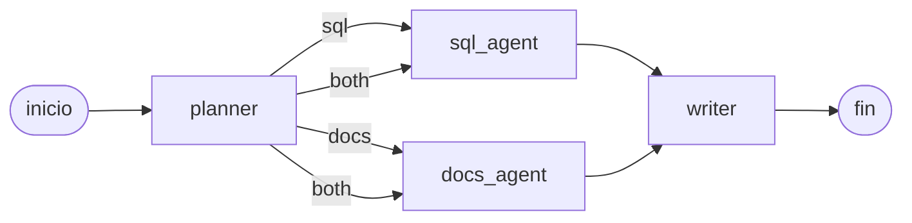

# Pedidos multiagente

Prueba técnica: un pequeño sistema que responde preguntas sobre pedidos de una tienda online.
Algunas preguntas se responden con datos (SQL sobre DuckDB), otras con las políticas de la
empresa (RAG) y otras con las dos cosas. Por debajo hay un grafo de agentes en LangGraph y una
API en FastAPI.

## Arrancarlo

Con Docker:

```bash
cp .env.example .env    # pon tu LLM_API_KEY
docker compose up --build
```

La API queda en http://localhost:8000 y Swagger en http://localhost:8000/docs. Al arrancar, el
contenedor regenera la base de datos a partir del CSV y deja el informe de calidad en `reports/`.

Si prefieres no usar una API de pago, también funciona con Ollama:

```bash
docker compose --profile local up -d ollama
docker compose exec ollama ollama pull qwen2.5:7b
docker compose exec ollama ollama pull nomic-embed-text
```

y en el `.env`:

```
LLM_BASE_URL=http://ollama:11434/v1
LLM_MODEL=qwen2.5:7b
EMBEDDINGS_MODEL=nomic-embed-text
```

Sin Docker:

```bash
python -m venv .venv && source .venv/bin/activate
pip install -e ".[dev]"
python -m app.data.pipeline
uvicorn app.api:app_factory --factory --reload
```

Tests:

```bash
pytest
```

Los tests no necesitan red ni clave: el LLM está simulado y los embeddings son locales.

## Probarlo

```bash
curl -s localhost:8000/ask -H 'content-type: application/json' \
  -d '{"question": "¿Cuántos clientes llevan más de 90 días sin comprar y qué descuento les podemos ofrecer?"}'
```

La respuesta trae:

- `answer`: el texto final.
- `route`: lo que decidió el planificador (`sql`, `docs` o `both`).
- `sql`: la consulta que se ejecutó realmente, ya validada y con su `LIMIT`.
- `sql_result`: las filas y todos los intentos, incluidos los fallidos.
- `citations`: el fichero y la sección de cada política usada.
- `trace`: cada paso del grafo con su duración.
- `usage`: los tokens consumidos en cada llamada.

Si algo falla, la API devuelve un JSON con `error`, `message` y la traza parcial:

- `429 token_budget_exceeded`: la petición se ha quedado sin tokens.
- `502 llm_unavailable`: el proveedor no responde o la clave es incorrecta.
- `502 llm_invalid_output`: el modelo ha devuelto algo que no se puede usar (JSON roto, una ruta
  que no existe, una respuesta vacía o truncada).
- `504 request_timeout`: se ha superado el tiempo máximo por petición.

## Los datos

`app/data/generate.py` crea el CSV (`data/raw/pedidos_raw.csv`) con semilla fija: 5.500 pedidos
más 180 duplicados. Los errores se meten a propósito:

- duplicados exactos y duplicados con espacios o mayúsculas distintos;
- fechas en cuatro formatos, más algunas imposibles como `31/02/2025` o `ayer`;
- importes vacíos, negativos, a cero o con coma decimal;
- países escritos como `España`, `ES`, `Spain`, `espana`, `ESP`... y alguno inventado.

`app/data/clean.py` limpia el fichero. Cada fila descartada se apunta con el primer motivo por el
que falla, y las filas que se corrigen (fechas, países, comas) se cuentan aparte. Con los datos
actuales entran 5.680 filas y se cargan 5.227:

| Motivo | Filas |
|---|---:|
| duplicado | 173 |
| importe_vacio | 105 |
| importe_no_positivo | 95 |
| fecha_invalida | 45 |
| pais_desconocido | 35 |

El detalle completo está en `reports/quality_report.md`. Todo el proceso se repite con
`python -m app.data.pipeline` y siempre da el mismo resultado.

Las vistas están en `app/data/views.sql`:

- `ventas_mes_pais`
- `top10_clientes`
- `clientes_inactivos_90d`

## Los agentes



- **planner**: le pide al modelo un JSON con la ruta y lo valida con Pydantic. Si la ruta es
  `both`, los agentes SQL y de documentos se ejecutan a la vez.
- **sql_agent**: genera la consulta, la valida y la ejecuta. Si falla en cualquiera de esos tres
  pasos, le pasa el error al modelo para que la corrija, con un máximo de 2 reintentos.
- **docs_agent**: busca los fragmentos más parecidos a la pregunta entre los cuatro documentos de
  `docs/policies/` (devoluciones, envíos, descuentos y garantía). Después pide al modelo una
  respuesta basada solo en esos fragmentos, indicando cuáles ha usado.
- **writer**: junta las dos partes en una respuesta. Si alguna ha fallado, lo dice en vez de
  inventarse algo.

### Validación del SQL

En lugar de buscar palabras prohibidas con regex, analizo la consulta con sqlglot y recorro el
árbol. Solo acepto:

- una única sentencia, y que sea de lectura;
- las tres vistas y la tabla `pedidos`;
- nada de `information_schema` ni funciones que lean ficheros o el entorno (`read_csv`, `getenv`,
  `duckdb_tables()`...).

La consulta final siempre va envuelta con un `LIMIT`. Por si se me hubiera escapado algo, la
conexión a DuckDB se abre en solo lectura y sin acceso a ficheros externos. Uno de los tests
comprueba precisamente que, aunque el validador dejara pasar un `DELETE` o un `read_csv`, la
conexión los rechazaría.

### Tiempo y tokens

- Cada petición tiene un tiempo máximo (`REQUEST_TIMEOUT_S`). También hay timeout en cada llamada
  al modelo y en las consultas.
- Cada petición tiene un presupuesto de tokens que comparten todos los agentes. Antes de cada
  llamada se estima si cabe y se ajusta `max_tokens`; después se suma lo que la API dice que se ha
  consumido de verdad.

## Decisiones

- **DuckDB en lugar de PostgreSQL**: para unos pocos miles de filas no necesito un servidor, y el
  compose queda con un solo servicio. El SQL es prácticamente estándar, así que pasarlo a Postgres
  no costaría mucho.
- **Cliente LLM compatible con OpenAI**: así sirve igual para OpenAI que para Ollama cambiando
  solo el `.env`.
- **Sin base de datos vectorial**: con cuatro documentos (16 fragmentos) tengo de sobra con una
  matriz de numpy en memoria. Para tests y para trabajar sin red hay un embedder local por hashing.
  No es semántico, pero para estos documentos acierta.
- **Fechas `dd/mm/yyyy`**: las interpreto siempre en formato español. Con datos reales habría que
  confirmarlo con quien los genera.
- **Importes negativos o a cero**: los descarto en vez de tratarlos como abonos, porque las
  devoluciones ya tienen su propio estado.
- **Qué cuenta como venta**: los pedidos `completado` y `enviado`.
- **Los 90 días**: se cuentan desde la última fecha del dataset, no desde hoy. Si no, con datos
  históricos todos los clientes saldrían inactivos.
- **Si el agente SQL agota los reintentos**, la petición no falla: la respuesta lo explica y la
  parte de documentos sigue siendo útil. Los fallos del modelo, de tiempo o de tokens sí son
  errores HTTP.

## Con más tiempo

- Un conjunto de preguntas de evaluación con respuestas esperadas, para medir si el SQL y las citas
  son correctos y no solo que el código funcione.
- Contar los tokens con el tokenizador del modelo, en lugar de estimarlos antes de cada llamada.
- Búsqueda híbrida (BM25 + embeddings) y caché de respuestas.
- PostgreSQL con un usuario de solo lectura y `statement_timeout`.
- Autenticación y límites por usuario.
- Devolver la traza en streaming.

## Uso de IA

Usé Claude Code como asistente durante el desarrollo:

- **Lo que le pedí**: ayuda para organizar el trabajo a partir del enunciado y para escribir buena
  parte del código y los tests.
- **Lo que acepté**: la estructura general, validar el SQL con sqlglot en lugar de regex y simular
  el LLM en los tests.
- **Lo que corregí**:
  - El primer generador dejaba al 60 % de los clientes como inactivos, así que ajusté la
    distribución de compras.
  - El volumen de la base de datos en el compose apuntaba a una ruta que no correspondía.
  - Comprobé a mano que cada caso de inyección se rechazaba por el motivo correcto y no por casualidad.
